<picture>
  <source media="(prefers-color-scheme: dark)" srcset="./assets/banner.svg?v=garden-1" />
  <source media="(prefers-color-scheme: light)" srcset="./assets/banner-day.svg" />
  
</picture>

 

コードと空想のあいだ · BETWEEN CODE &amp; DAYDREAMS

### 你好呀，这里是 RainFoam ฅ՞•ﻌ•՞ฅ

写一点代码，收集一点快乐。

JavaScript &nbsp; / &nbsp; Python &nbsp; / &nbsp; Plugins &amp; Bots

  

---

01 &nbsp; / &nbsp; ABOUT THIS CORNER

在插件、Bot 和有趣的小工具之间探索。  
把零散的灵感写进代码，让小小的想法慢慢发光。

 

02 &nbsp; / &nbsp; GITHUB IN NUMBERS

  

<picture>
  <source media="(prefers-color-scheme: dark)" srcset="./assets/stats-night.svg" />
  
</picture>
<picture>
  <source media="(prefers-color-scheme: dark)" srcset="./assets/languages-night.svg" />
  
</picture>

  

03 &nbsp; / &nbsp; A LITTLE SNAKE, A YEAR OF CODE

  

<picture>
  <source media="(prefers-color-scheme: dark)" srcset="./assets/snake-night.svg" />
  
</picture>

 

04 &nbsp; / &nbsp; 留给路过的你 🐾

 

<pre>
 /\_/\
( ˶• . •˶ )
 / &gt;✧  送你一颗小星星
</pre>

今天也辛苦啦，记得给自己留一点发呆的时间。

 

<picture>
  <source media="(prefers-color-scheme: dark)" srcset="./assets/garden-night.svg" />
  <source media="(prefers-color-scheme: light)" srcset="./assets/garden-day.svg" />
  
</picture>

小小的想法，也有自己的星光。 
Thanks for stopping by. &nbsp; またね ♡

