 

### 你好呀，这里是 RainFoam ฅ՞•ﻌ•՞ฅ

**写一点代码，收集一点快乐。**

Welcome to my little corner of GitHub · 路过的话，就坐下来歇一会儿吧

  

 

### ୨୧ · 猫猫的兴趣角落

🎐 在 GitHub 记录折腾代码的小日常。  
🧩 在插件、Bot 和各种有趣的小工具之间探索。  
🌸 喜欢可爱的东西，也想让做出来的东西更好用一点。

 

### ୨୧ · 小小作品架

<table>
<tr>
<td width="50%" valign="top">

#### 🧩 [TRSS-Plugin](https://github.com/RainFoam0693/TRSS-Plugin)

我的 JavaScript 插件仓库。把一点点想法，变成可以用起来的小功能。

JavaScript · 插件折腾日记

</td>
<td width="50%" valign="top">

#### 🌊 [WutheringWavesUID](https://github.com/RainFoam0693/WutheringWavesUID)

鸣潮 Bot 插件的 Fork，收集与探索游戏 Bot 的各种可能。

Fork 自 <a href="https://github.com/CM-Edelweiss/WutheringWavesUID">CM-Edelweiss/WutheringWavesUID</a>

</td>
</tr>
</table>

 

🐾 点这里，捡到一只猫猫

 

<pre>
 /_/( ˶• . •˶ )
 / &gt;🌸  给你一朵小花
</pre>

今天也辛苦啦，记得给自己留一点发呆的时间。

 

**✧ 愿每一个小小的想法，都能慢慢发光 ✧**

Thanks for stopping by · またね ♡

